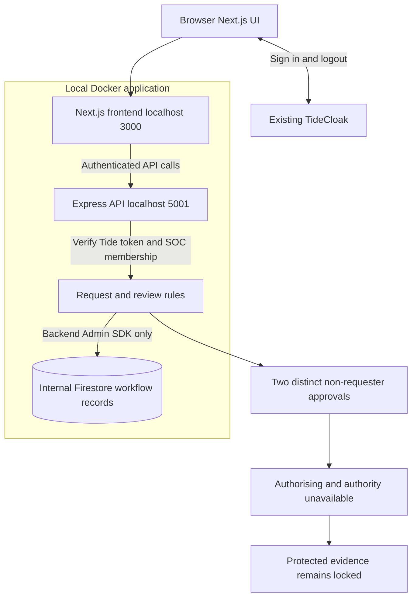
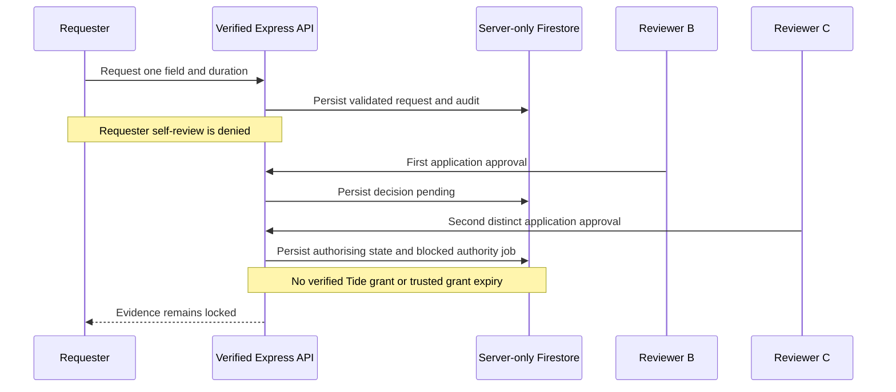

# Architecture

The Next.js frontend uses TideCloak front-channel login. Every feature API goes
directly to Express with a current Tide access token in an Authorization header.
The backend independently verifies signature, issuer, client azp and time claims,
then recognises four equal SOC membership labels. /api/me stays authentication-only.

Firestore is server-only through backend/src/lib/firebase.ts. Direct-client
rules deny all access; there is no Firebase SDK in the frontend. The local demo
uses an explicit demo project/emulator without service accounts or cloud fallback.
The Cloud Function api export is preserved; server.ts is the native/Docker listener.
Approved Docker publishes only frontend/backend on localhost 3000/5001. Backend
uses internal firestore:8085; browser Tide entry remains localhost:8080. The
existing Tide container/data are external to SOC Compose. Owner Docker restart
retention and internal client GET 403 passed; see [deployment](SOC-WEEK9-DEPLOYMENT.md)
for separate owner/static evidence and current release identity.

## Current flow

1. A recognised SOC member submits a validated read-only request for one
   protected field. The server derives issuer/subject ownership and trusted time.
2. A Firestore transaction enforces one open requester/incident/resource scope,
   writes the request/operation ledger and appends request-created audit.
3. Other recognised SOC members may approve or reject pending requests.
   Self-review and duplicate decisions are denied. Concurrent operations use
   Firestore retries and atomic state transitions.
4. The first approval remains pending. The second writes authorising, a stable
   blocked authority job and an authority-unavailable audit event.
5. Evidence stays locked. The application cannot currently establish genuine
   scoped Tide authority or signed expiry; an active database flag is insufficient.
6. Safe history, review and audit views use authenticated no-store API responses.
   Metadata state drops late responses and rechecks on reconnection/visibility.

## Code map for this stage

| Module                                                       | Responsibility                                                                     |
| ------------------------------------------------------------ | ---------------------------------------------------------------------------------- |
| backend/src/access/types.ts                                  | Strict input/storage schemas, stable actor reference, safe public projection       |
| backend/src/access/store.ts                                  | Real Firestore transactions, buffered writes, bounded queries                      |
| backend/src/access/service.ts                                | Request state machine, operation idempotency, audit, fail-closed evidence boundary |
| backend/src/routes/access.ts                                 | Membership-gated request/review/audit/config/status routes                         |
| backend/src/lib/demoConfig.ts                                | Exact demo project/host validation and optional short duration                     |
| backend/src/server.ts                                        | Native readiness checks and graceful backend listener                              |
| frontend/src/lib/api/access.ts                               | No-store authenticated JSON calls, safe service errors                             |
| frontend/src/features/access-requests/hooks/useAccessData.ts | Session/context invalidation, rechecks, retry operation IDs                        |
| frontend/src/features/access-requests/components             | Submission, history, review, audit and incident status                             |
| scripts/demo.cjs / test-emulator.cjs                         | Native launch and isolated export/import integration probe                         |
| docker-compose.soc-demo.yml                                  | Application demo containers; existing Tide setup is external                       |

The existing frontend Server Action session helpers remain fail-closed placeholders;
this stage uses the verified Express APIs. Client role guards are a UX boundary.
No new production dependencies, authentication provider or role hierarchy was added.

The mandatory Tide integration is incomplete. See SOC-TIDE-CAPABILITIES.md for
verified sources, exact unknowns and the manual setup boundary. Group startup and
testing are in SOC-POC-RUNBOOK.md. Repository guardrail files remain unchanged.

## Editable presentation diagrams

These describe the current local runtime, not public hosting. Application approval
never substitutes for a Tide grant. Re-render older exported diagrams from this
source; do not use the main-branch Vercel/optional-backend diagram.

